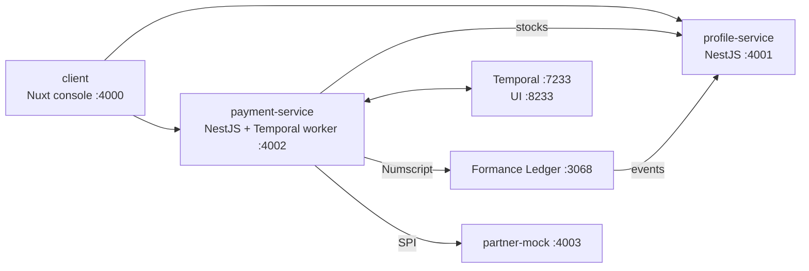

# Payment Formance POC

Proof of concept for a mobile bank's core payment system:
- **[Formance Ledger](https://www.formance.com/)** is the ledger.
- **[Temporal](https://temporal.io/)** orchestrates every payment as a saga.
- **The data model** follows the planned *Payment Engine & Profile Schema*:
  - **Profiles, accounts and stocks:** individuals, agents and the bank itself hold accounts, each with one stock per currency.
  - **Configuration:** service groups → services → commands → tiers, where amount rules (fixed / percentage / formula) price every amount type and from → to balance movements decide who pays whom.
  - **SPIs:** provider calls before payment, after payment, and for notifications.
- **Orders** are reserved, authorized, settled and confirmed. On failure they're compensated with new ledger transactions.



## Run it

Requirements: Docker Desktop, Node.js 24, and [Task](https://taskfile.dev) (`brew install go-task`).

```bash
task dev
```

That builds and starts everything, seeds the example configuration, then runs the smoke test and the Bruno API collection.

When it's up:

| URL | What |
| --- | --- |
| http://localhost:4000 | Console: profiles, stocks and balances, payment orders with their saga, service configuration |
| http://localhost:8233 | Temporal UI: every order's saga, step by step |
| http://localhost:4001/docs | Profile Service API (Swagger) |
| http://localhost:4002/docs | Payment Engine API (Swagger) |

## A payment

```bash
# 1. Create the order: priced by the matching tier, money reserved → 201 PENDING
curl -X POST localhost:4002/payments -H 'content-type: application/json' -H "Idempotency-Key: $(uuidgen)" \
  -d '{"serviceCode":"MERCHANT_QR_USD","amount":"20.00","payerStockId":"<payer stock>","payeeStockId":"<payee stock>"}'

# 2. The customer authorizes → PROCESSING → COMPLETED
curl -X POST localhost:4002/payments/<order id>/authorize -H 'content-type: application/json' -d '{}'
```

Amounts are decimal strings in the service's currency. Refund or cancel with `POST /payments/:id/refund` and `POST /payments/:id/cancel`.

## Repository layout

| Path | What |
| --- | --- |
| [profile/](profile/README.md) | Profile Service: profiles, account products, stocks, balance mirror |
| [payment/](payment/README.md) | Payment Engine: configuration, pricing, movements, orders, Temporal saga, Formance |
| [partner-mock/](partner-mock/README.md) | Mock biller for external SPI calls |
| [client/](client/README.md) | Nuxt 4 + shadcn-vue + Tailwind console |
| [architecture/](architecture/README.md) | Docker Compose dev environment, Postgres init, smoke test |
| [bruno/](bruno/) | Bruno API collection covering every endpoint, with tests |
| [docs/](docs/README.md) | Proposal, plan and the data model ([05-schema.md](docs/05-schema.md)) |

## Tests

| Command | Covers |
| --- | --- |
| `task test` | Unit tests: formulas, amount rules, movements, ledger plan |
| `task smoke` | 40 end-to-end checks: KYC, cash-in, holds, authorization, SPI rejections with compensation, refunds, cancels, concurrency, tier validation |
| `task bruno` | 81 API requests with 127 assertions |

No credentials are stored in this repository. `task up` generates random local database passwords into `architecture/.env`, which is gitignored.
