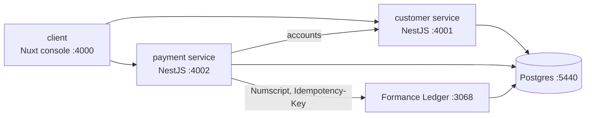

# Payment Formance POC

Proof of concept for using [Formance Ledger](https://www.formance.com/) as the core ledger of a mobile bank's payment system.

**What's in it:**
- Customers each get a USD and a KHR account.
- Payments, refunds and cancels run through configurable services.
- Every amount type (selling price, fees, commissions, VAT, cash back, …) comes from pricing tiers.
- Money moves by debit/credit movements that must balance before they can be saved.
- Every balance is read from Formance.



## Run it

Requirements: Docker Desktop, Node.js 24, and [Task](https://taskfile.dev) (`brew install go-task`).

```bash
task dev
```

That builds and starts everything, loads the example services, then runs the end-to-end smoke test and the Bruno API collection.

When it's up:

| URL | What |
| --- | --- |
| http://localhost:4000 | Console: customers, USD/KHR assets, transaction history, ledger postings |
| http://localhost:4001/docs | Customer service API (Swagger) |
| http://localhost:4002/docs | Payment service API (Swagger) |
| http://localhost:3068 | Formance Ledger API |

Run `task` to list every command (`up`, `down`, `reset`, `logs`, `seed`, `smoke`, `bruno`, `test`, `typecheck`, …).

## Perform a payment

```bash
curl -X POST localhost:4002/payments \
  -H 'content-type: application/json' -H "Idempotency-Key: $(uuidgen)" \
  -d '{"serviceCode":"MERCHANT_QR","amount":"2000","currency":"USD","source":"<payer id>","destination":"<payee id>"}'
```

Amounts are strings in the smallest unit (`2000` = $20.00). The response includes:
- `status`: `posted`, `failed` or `pending`.
- `sourceNet` and `destinationNet`: what the payer and payee each actually gained or lost.
- `amounts`: every amount type that was calculated.

Refund or cancel with `POST /payments/:id/refund` and `POST /payments/:id/cancel`.

## Repository layout

| Path | What |
| --- | --- |
| [customer/](customer/README.md) | NestJS + Drizzle: customers and their USD/KHR accounts |
| [payment/](payment/README.md) | NestJS + Drizzle: services, pricing tiers, balanced movements, transfers, outbox, Formance integration |
| [client/](client/README.md) | Nuxt 4 + shadcn-vue + Tailwind console |
| [architecture/](architecture/README.md) | Docker Compose dev environment, Postgres init, smoke test |
| [bruno/](bruno/) | Bruno API collection covering every endpoint, with tests |
| [docs/](docs/README.md) | Proposal, architecture, data model ([05-schema.md](docs/05-schema.md)), implementation plan |

## Tests

| Command | Covers |
| --- | --- |
| `task test` | Unit tests: pricing, balance check, posting plan, Numscript |
| `task smoke` | 33 end-to-end checks against the running stack, including concurrency and idempotency |
| `task bruno` | 62 API requests with 120 assertions |

No credentials are stored in this repository. `task up` generates random local database passwords into `architecture/.env`, which is gitignored (see [architecture/README.md](architecture/README.md#database-credentials)).
