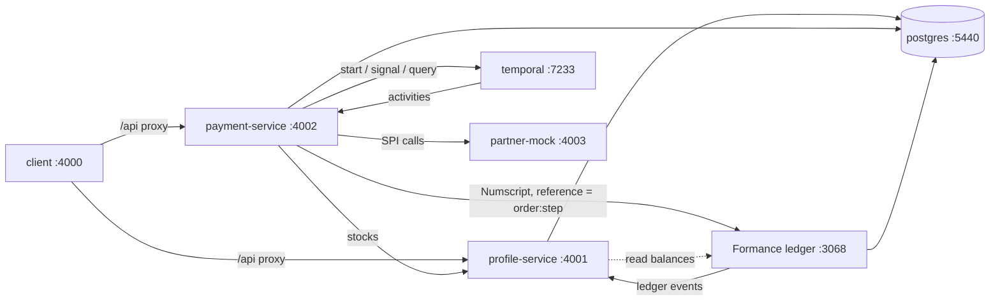

# Local development environment

Everything runs in Docker. Start it from the repository root with [Task](https://taskfile.dev) (`brew install go-task`):

```bash
task dev      # build + start everything, seed the example configuration, run the smoke test and Bruno
task up       # build + start everything
task down     # stop (data kept)
task reset    # stop and delete all local data
```

Run `task` to list every command.

## What runs

| Container | Host port | What it is |
| --- | --- | --- |
| `postgres` | 5440 | Postgres 16: databases `profile`, `payment`, `ledger`, one role each (see `postgres/init.sh`) |
| `ledger` | 3068 | Formance Ledger v2.4.15 API; publishes every transaction to the Profile Service (`/ledger-events`) |
| `ledger-worker` | – | Formance Ledger background worker |
| `temporal` | 7233, UI **8233** | Temporal dev server (SQLite in a volume) with its web UI — every order's saga |
| `partner-mock` | 4003 | Mock biller used as an external SPI (`/validations`, `/confirmations`, failure switch) |
| `profile-service` | 4001 | NestJS: profiles, account products, stocks (balances mirrored from Formance). Swagger at `/docs` |
| `payment-service` | 4002 | NestJS: service configuration and payment orders (Temporal worker inside). Swagger at `/docs` |
| `client` | 4000 | Nuxt 4 console |



Each service runs its Drizzle migrations on start-up. The payment engine creates the `mobilebank` ledger in Formance if it doesn't exist.

## Hot reload

`profile/`, `payment/`, `client/` and `partner-mock/server.mjs` are bind-mounted, and saving a file reloads it. `node_modules` live in Docker volumes; after changing a `package.json`, run `task rebuild`. If a service ever misses a change, `task restart -- payment-service`.

## Database credentials

No passwords are stored in this repository:
- `task env` (which `task up` runs automatically) creates `architecture/.env` from `.env.example`, with a random password for each value.
- That file is gitignored and readable only by you (`chmod 600`).
- `docker-compose.yml` refuses to start without it.
- `postgres/init.sh` creates the service roles from those values when the Postgres volume is first created.

| Database | User | Password variable in `architecture/.env` |
| --- | --- | --- |
| profile | `profile_svc` | `PROFILE_DB_PASSWORD` |
| payment | `payment_svc` | `PAYMENT_DB_PASSWORD` |
| ledger | `ledger` | `LEDGER_DB_PASSWORD` |
| (superuser) | `postgres` | `POSTGRES_PASSWORD` |

**Shortcuts:**
- `task db:psql -- payment` opens a SQL shell.
- `task db:studio -- payment` opens Drizzle Studio.

**Changing a password:** after you edit `.env`, run `task reset`, because the roles are only created once.

## Walkthrough

After `task up && task seed`. Use the stock ids from the console or `GET /profiles/:id`.

```bash
# 1. A customer: INDIVIDUAL with KYC → ACTIVE, CURRENT account with USD + KHR stocks
curl -s -X POST localhost:4001/profiles -H 'content-type: application/json' \
  -d '{"profileType":"INDIVIDUAL","fullName":"Sok Dara","phoneNumber":"+85512345678","kycVerified":true}'

# 2. Cash-in $100 from the bank's Settlement stock (bank payer: no authorization)
curl -s -X POST localhost:4002/payments -H 'content-type: application/json' -H "Idempotency-Key: $(uuidgen)" \
  -d '{"serviceCode":"CASH_IN_USD","amount":"100.00","payerStockId":"<bank settlement USD stock>","payeeStockId":"<Dara USD stock>"}'

# 3. Merchant QR payment of $20: priced by the tier (fee 5%), $21.00 held → PENDING
curl -s -X POST localhost:4002/payments -H 'content-type: application/json' -H "Idempotency-Key: $(uuidgen)" \
  -d '{"serviceCode":"MERCHANT_QR_USD","amount":"20.00","payerStockId":"<Dara USD stock>","payeeStockId":"<merchant USD stock>"}'

# 4. Authorize → PROCESSING → COMPLETED
curl -s -X POST localhost:4002/payments/<order id>/authorize -H 'content-type: application/json' -d '{}'

# 5. Bill payment with the biller as an SPI; externalReference REJECT-… makes the biller refuse after
#    the money moved → movements reverted, hold released, FAILED
curl -s -X POST localhost:4002/payments -H 'content-type: application/json' -H "Idempotency-Key: $(uuidgen)" \
  -d '{"serviceCode":"EDC_BILL_USD","amount":"10.00","payerStockId":"<Dara USD stock>","payeeStockId":"<bank EDC payable USD stock>","externalReference":"REJECT-1"}'
```

Open http://localhost:8233 to watch each saga step by step.

**Bruno:** open `bruno/` in the Bruno app with the `local` environment, or run `task bruno`. It covers every endpoint (81 requests), creates its own bank, customers, SPI and services, and needs no seed.

## Troubleshooting

- **Postgres logs "No space left on device":** Docker Desktop's disk is full. Run `docker builder prune` or raise the disk limit.
- **The service won't start after you add a dependency:** run `task rebuild`.
- **A saga looks stuck:** open it in the Temporal UI (http://localhost:8233). Activities retry with backoff, and the failing step and its error are shown there.
- **You want a clean slate:** `task reset`, then `task dev`.
