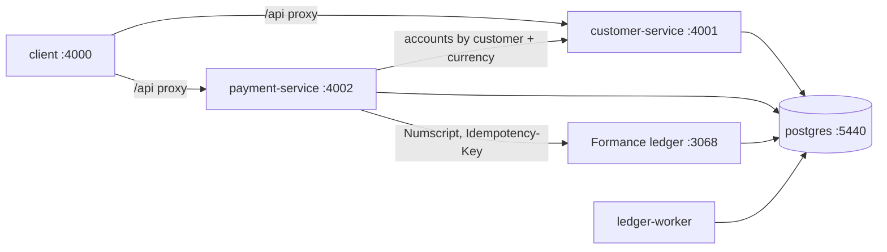

# Local development environment

Everything runs in Docker. Start it from the repository root with [Task](https://taskfile.dev) (`brew install go-task`):

```bash
task dev      # build + start everything, seed example services, run the smoke test
task up       # build + start everything
task down     # stop (data kept)
task reset    # stop and delete all local data
```

Run `task` to list every command.

## What runs

| Container | Host port | What it is |
| --- | --- | --- |
| `postgres` | 5440 | Postgres 16. Three databases, one role each: `customer`, `payment`, `ledger` (see `postgres/init.sql`) |
| `ledger` | 3068 | Formance Ledger v2.4.15 API (`serve`) |
| `ledger-worker` | – | Formance Ledger background worker |
| `customer-service` | 4001 | NestJS: customers and their USD / KHR accounts. Swagger at `/docs` |
| `payment-service` | 4002 | NestJS: services, commands, pricing tiers, balance movements, transfers, balances. Swagger at `/docs` |
| `client` | 4000 | Nuxt 4 console: customers, USD/KHR assets, transaction history, ledger postings |



- Each service runs its Drizzle migrations on start-up.
- The payment service creates the `mobilebank` ledger in Formance if it doesn't exist yet.

## Hot reload

`customer/`, `payment/` and `client/` are bind-mounted into their containers. The services run `nest start --watch` and the client runs `nuxt dev`, so saving a file reloads it. `node_modules` live in Docker volumes, separate from the host. After changing a `package.json`, run `task rebuild`.

## Database credentials

No passwords are stored in this repository:
- `task env` (which `task up` runs automatically) creates `architecture/.env` from `.env.example`, with a random password for each value.
- That file is gitignored and readable only by you (`chmod 600`).
- `docker-compose.yml` refuses to start without it.
- `postgres/init.sh` creates the service roles from those values the first time the Postgres volume is created.

| Database | User | Password variable in `architecture/.env` |
| --- | --- | --- |
| customer | `customer_svc` | `CUSTOMER_DB_PASSWORD` |
| payment | `payment_svc` | `PAYMENT_DB_PASSWORD` |
| ledger | `ledger` | `LEDGER_DB_PASSWORD` |
| (superuser) | `postgres` | `POSTGRES_PASSWORD` |

Connection URLs from the host look like `postgresql://payment_svc:<PAYMENT_DB_PASSWORD>@localhost:5440/payment`. Shortcuts:
- `task db:psql -- payment` opens a SQL shell.
- `task db:studio -- payment` opens Drizzle Studio.

**Changing a password:** after you edit `.env`, run `task reset` to recreate the volume, because the roles are only created once.

## Walkthrough

```bash
# 1. Create a customer (USD + KHR accounts are created with it)
curl -s -X POST localhost:4001/customers -H 'content-type: application/json' \
  -d '{"fullName":"Sok Dara","phoneNumber":"+85512345678"}'

# 2. Top up $200.00 (amounts are strings in the smallest unit: 20000 = $200.00)
curl -s -X POST localhost:4002/topups -H 'content-type: application/json' -H 'Idempotency-Key: topup-1' \
  -d '{"customerId":"<id>","currency":"USD","amount":"20000","externalRef":"bank-ref-1"}'

# 3. Pay an electricity bill of $100.00: the payer is debited the selling price ($100.25 = amount + fee)
curl -s -X POST localhost:4002/payments -H 'content-type: application/json' -H 'Idempotency-Key: pay-1' \
  -d '{"serviceCode":"EDC_BILL","amount":"10000","currency":"USD","source":"<id>"}'

# 4. Pay a merchant by QR (needs a payee): payer −$21.00, merchant +$20.00, fee account +$1.00
curl -s -X POST localhost:4002/payments -H 'content-type: application/json' -H 'Idempotency-Key: qr-1' \
  -d '{"serviceCode":"MERCHANT_QR","amount":"2000","currency":"USD","source":"<payer id>","destination":"<merchant id>"}'

# 5. Refund part of the bill, or cancel it (service, currency and customers come from the payment)
curl -s -X POST localhost:4002/payments/<payment id>/refund -H 'content-type: application/json' -H 'Idempotency-Key: ref-1' \
  -d '{"amount":"4000"}'
curl -s -X POST localhost:4002/payments/<payment id>/cancel -H 'Idempotency-Key: cancel-1'

# 6. Balances (read live from Formance)
curl -s localhost:4002/customers/<id>/balances
curl -s localhost:4002/services/EDC_BILL/balances
```

**Bruno:** open the `bruno/` folder in the Bruno app and pick the `local` environment, or run `task bruno`. It's a 62-request collection covering every endpoint, with tests. It creates its own customers and service, so it can run any number of times and doesn't need the seed.

Every write needs an `Idempotency-Key` header. Sending the same key again returns the original transfer instead of creating a new one.

A transfer response has `status`:
- `posted`: the ledger accepted it.
- `failed`: the ledger rejected it, e.g. `failureReason: "insufficient_fund"`. No money moved.
- `pending`: the ledger wasn't reachable. The outbox worker retries it in the background.

## Troubleshooting

- **Postgres logs "No space left on device" or "could not write init file":** Docker Desktop's disk is full. Run `docker builder prune` or raise the disk limit in Docker Desktop.
- **The service won't start after you add a dependency:** run `task rebuild`.
- **You want a clean slate:** run `task reset`, then `task dev`.
