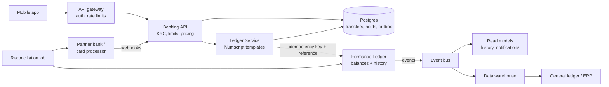

# Target architecture

Only the Ledger Service writes to Formance. The mobile app, partner webhooks and back-office tools all go through our API, which records the business intent in Postgres first and then posts it to the ledger.

| Component | Owns | Does not own |
| --- | --- | --- |
| Banking API | Customer rules: KYC, limits, fees, card controls | Balances |
| Ledger Service | Numscript templates, posting, retries, reversals | Business decisions |
| Postgres | Transfer intent and state, holds, outbox, recon results | Money balances |
| Formance Ledger | Balances, postings, immutable history | Customer data (only IDs in metadata) |
| Reconciliation job | Daily match of ledger vs. partner statements | Fixing breaks automatically |
