# Chart of accounts

> **Note:** this section was written before the two-account model. Customer accounts are now `users:{customer_id}:usd` and `users:{customer_id}:khr`, and service accounts are `services:{service_code}:usd|khr` (see [05-schema.md](05-schema.md)). The savings, hold and card accounts below are not in the current scope.

Account names are paths that describe a business boundary. One ledger per legal entity (e.g. `mobilebank-prod`), with assets in their smallest unit (`USD/2` = cents).

```mermaid
flowchart TB
    W["@world<br/>outside the system"]
    subgraph CUST["Customer accounts"]
        M["users:{id}:main"]
        S["users:{id}:savings"]
        H["users:{id}:holds:{ref}"]
    end
    subgraph TRANSIT["In transit"]
        WD["transit:withdrawals:{id}"]
        CS["card:settlement"]
    end
    subgraph PLAT["Platform"]
        F["platform:fees:{type}"]
        P["platform:promotions"]
        SUS["platform:suspense"]
    end
    W --> M
    M --> H
    M --> S
    M --> WD
    H --> CS
    M --> F
    P --> M
    WD --> W
    CS --> W
```

| Address pattern | Purpose | May go negative? |
| --- | --- | --- |
| `@world` | Money entering or leaving the system | Yes (built in) |
| `users:{id}:main` | Customer spendable balance | Only with an approved overdraft limit |
| `users:{id}:savings` | Savings pocket | No |
| `users:{id}:holds:{ref}` | Funds reserved for one card authorization | No |
| `transit:withdrawals:{id}` | Withdrawal sent to the partner bank, awaiting confirmation | No |
| `card:settlement` | Captured card spend owed to the card scheme | No |
| `platform:fees:{type}` | Fee revenue per product (p2p, atm, fx) | No |
| `platform:promotions` | Funded cashback and bonuses | No (pre-funded) |
| `platform:suspense` | Unidentified incoming money awaiting investigation | No |

**Rules:** no customer names or personal data in addresses, only internal IDs. Every transaction carries metadata `transfer_id`, `type` and `channel`. A customer's available balance = `users:{id}:main`. Held funds are visible as the sum of `users:{id}:holds:*`.
