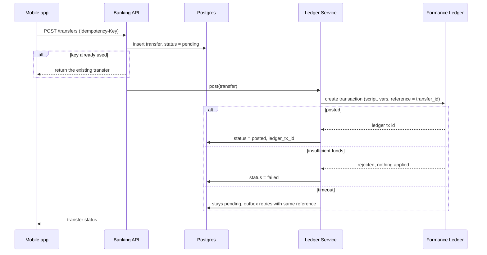
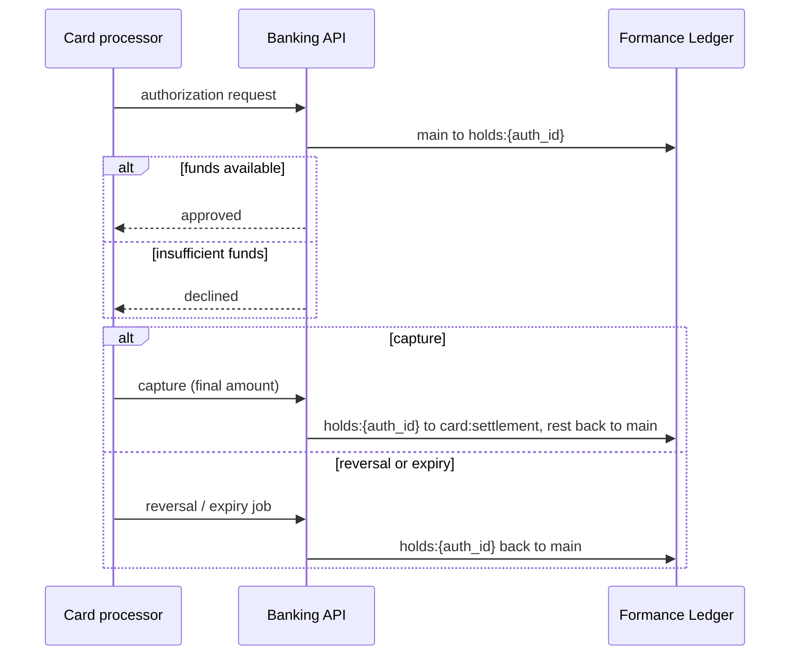
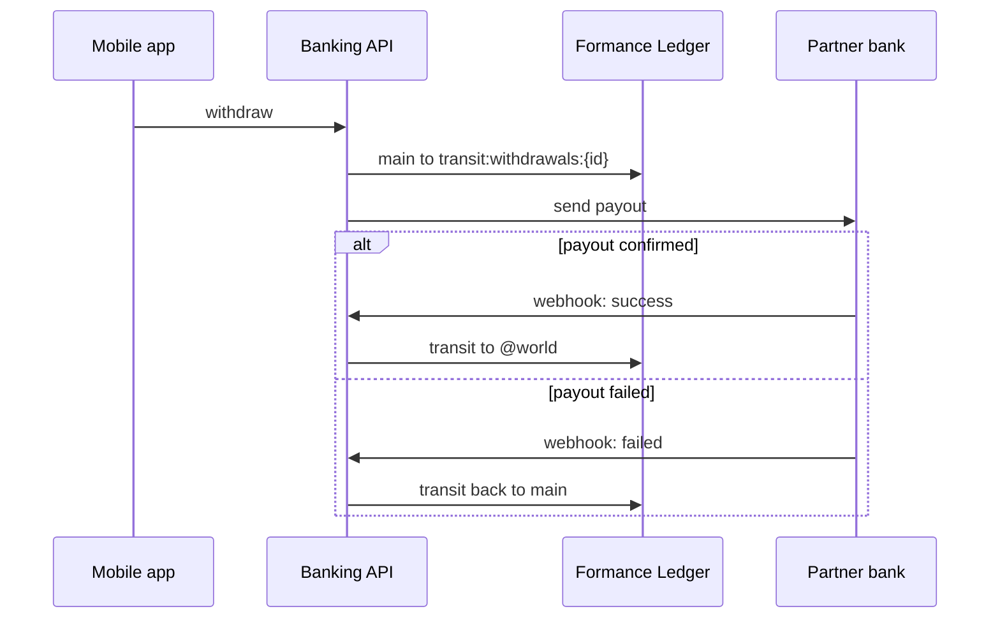

# Transaction flows

> **Note:** these flows were written before the two-account and service model. `users:{id}:main` now means `users:{customer_id}:usd` or `:khr`. Customer payments now run through service commands (see [05-schema.md](05-schema.md#service-transaction-flow)), and cards are out of scope for now.

Every flow follows the same pattern: record the intent in Postgres, post one Numscript transaction with `reference = transfer_id`, then record the result. If the ledger call times out, we retry with the same reference, so it never posts twice. The Numscript below is a proposal; we will check it against the v3.2 Numscript reference in Phase 0.

## Common posting pattern



## 1. Top-up (incoming bank transfer)

The partner bank's webhook triggers this. Money enters from `@world`.

```
vars {
  monetary $amount
  account $user
}
send $amount (
  source = @world
  destination = $user
)
set_tx_meta("type", "topup")
```

## 2. Peer-to-peer (P2P) transfer with fee

One transaction moves the amount and the fee. It is rejected as a whole if the sender's balance is too low.

```
vars {
  monetary $amount
  monetary $fee
  account $from
  account $to
}
send $amount (
  source = $from
  destination = $to
)
send $fee (
  source = $from
  destination = @platform:fees:p2p
)
set_tx_meta("type", "p2p")
```

## 3. Card payment: authorize, capture, release (deferred)



```
// authorize
vars { monetary $amount  account $main  account $hold }
send $amount ( source = $main  destination = $hold )

// capture (final amount can be lower than the hold)
vars { monetary $final  account $main  account $hold }
send $final ( source = $hold  destination = @card:settlement )
send [USD/2 *] ( source = $hold  destination = $main )
```

## 4. Withdrawal to an external bank account

Funds move to a transit account first, so they cannot be spent twice while the partner bank processes the payment.



## 5. Corrections

Posted transactions are never edited. A mistaken posting is undone with the ledger's revert operation, which creates a new opposite transaction. A partial correction is a new transaction with metadata `corrects = <original tx id>`.
