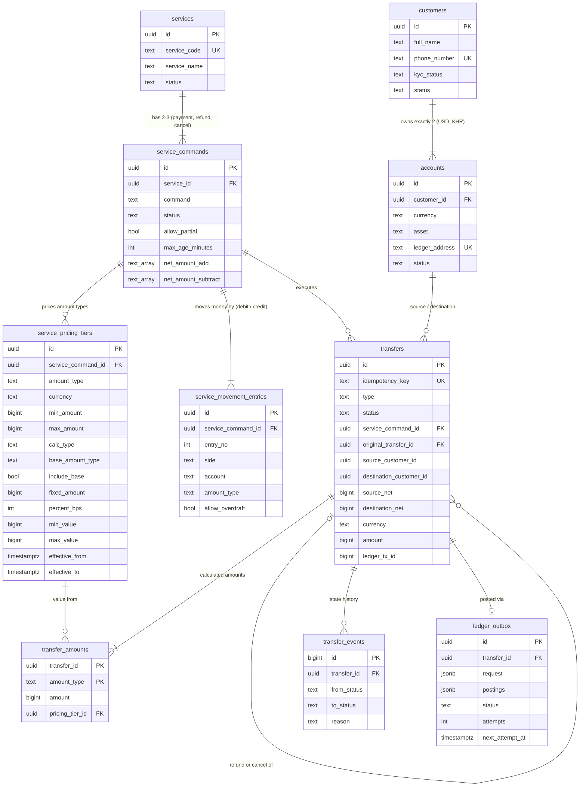
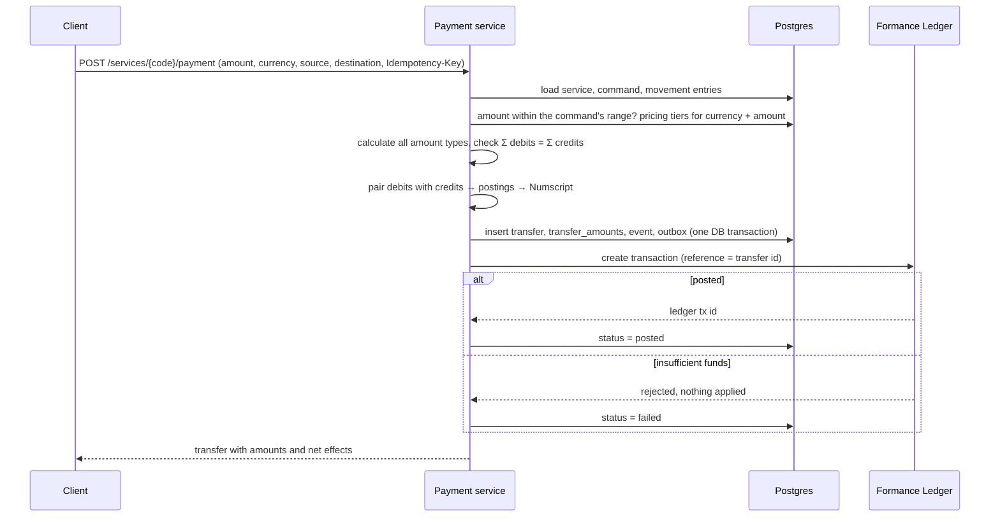
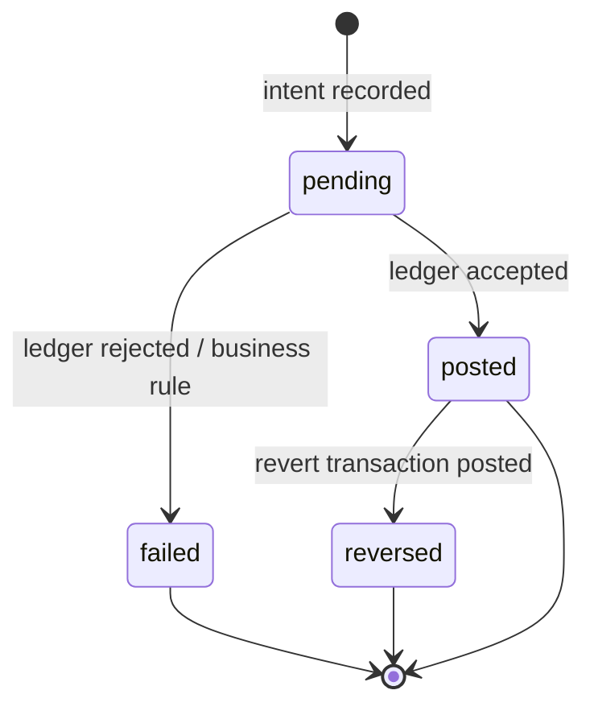

# Table schema design

Postgres stores business intent, configuration and state; Formance stores money. No table holds a balance as the source of truth — balances are read from Formance.

- **Customer service database:** `customers`, `accounts` (exactly two per customer: USD and KHR).
- **Payment service database:** `services`, `service_commands`, `service_pricing_tiers`, `service_movement_entries`, `transfers`, `transfer_amounts`, `transfer_events`, `ledger_outbox`.
- Links between the two services (e.g. a transfer's customers) are logical only; there are no cross-database foreign keys.
- **Designed but not built yet:** `balance_snapshots` (cached balances), `processed_ledger_events`, and the reconciliation tables.

## Amount types

Every money component of a transaction has one of these 16 types:

| Type | Where its value comes from |
| --- | --- |
| `amount` | The request (the only value the caller sends) |
| `selling_price`, `fee_from_customer`, `fee_from_partner`, `commission_to_agent_1`, `commission_to_agent_2`, `commission_to_partner`, `platform_commission`, `service_charge`, `cancellation_fee`, `discount`, `cash_back`, `purchasing_cost`, `withholding_tax`, `vat` | The command's pricing tier for that type, currency and amount band. 0 when no tier applies |
| `net_amount` | Per command: `amount + Σ net_amount_add − Σ net_amount_subtract` |

## Service configuration

A transaction request carries only **service + command, amount, currency, source (payer) and destination (payee)**. Everything else is configured per command, in three steps:

1. **Command settings** (`service_commands`): status; for refund/cancel the time window and whether partial refunds are allowed; the net-amount formula.
2. **Pricing tiers** (`service_pricing_tiers`): how each amount type is calculated.
3. **Balance movement** (`service_movement_entries`): which account is debited or credited with which amount type. It **can only be saved if it balances**.

### `services`

| Column | Type | Notes |
| --- | --- | --- |
| id | uuid PK | Service ID |
| service_code | text, unique | e.g. `EDC_BILL`; replaces `{service}` in account paths (lower-cased) |
| service_name | text | Display name |
| status | text | `active`, `suspended`, `inactive`; only `active` services run commands |

### `service_commands`

| Column | Type | Notes |
| --- | --- | --- |
| service_id | uuid FK | |
| command | text | `payment`, `refund`, `cancel`; unique per service |
| status | text | `active`, `disabled` |
| allow_partial | bool | Refund only: allow less than the original amount |
| max_age_minutes | int, nullable | Refund/cancel: latest time after the original payment |
| net_amount_add / net_amount_subtract | text[] | Priced types added to / subtracted from `amount` to get `net_amount` |

### `service_pricing_tiers`

One row per amount type, currency and band of the request amount. Bands for the same type and currency can't overlap while in effect (a Postgres `EXCLUDE` constraint).

| Column | Type | Notes |
| --- | --- | --- |
| amount_type | text | Any type except `amount` and `net_amount` |
| currency | text | `USD` or `KHR` |
| min_amount, max_amount | bigint | Band on the request amount (smallest unit, inclusive; `max_amount` null = no limit) |
| calc_type | text | `fixed`, `percent`, `fixed_plus_percent` |
| base_amount_type | text | What the percentage is taken of: `amount` (default) or another priced type (one level deep, e.g. VAT = 10% of `fee_from_customer`) |
| include_base | bool | Add the base itself: `selling_price = amount + amount × 5%` |
| fixed_amount, percent_bps | bigint, int | Fixed part; percentage in basis points (500 = 5%) |
| min_value, max_value | bigint, nullable | Clamp the calculated part (not the included base) |
| effective_from, effective_to | timestamptz | A new price starts on a date; old rows are retired, never edited |

value = `(include_base ? base : 0) + clamp(fixed_amount + base × percent_bps / 10,000, min_value, max_value)`. The percentage is rounded half-up to the smallest unit.

**Amount range:** the bands of a command, per currency, also define which amounts it accepts, from the lowest band to the highest. A payment outside that range is rejected. A currency with no tiers accepts any amount, but only if the movement balances without priced types; otherwise that currency isn't offered for this command.

### `service_movement_entries`

Double entry: every entry debits or credits one account with one amount type.

| Column | Type | Notes |
| --- | --- | --- |
| entry_no | int | Order; unique per command |
| side | text | `debit` or `credit` |
| account | text | `{source}` (payer), `{destination}` (payee), `@world`, or a specific account path such as `platform:fees:{service}`; `:usd` / `:khr` is appended |
| amount_type | text | One of the 16 amount types |
| allow_overdraft | bool | Specific accounts only (e.g. a marketing budget paying cash back) |

**Balance check before save:**
- For each currency, the payment service evaluates the pricing tiers at sample amounts: every band's edges and midpoint, plus a spread of round numbers within the command's amount range.
- At each sample it checks Σ debits = Σ credits. If any amount fails, the save is rejected with the failing amounts.
- `POST …/movement/check` runs the same check without saving.
- Adding a tier doesn't block, but its response includes the movement check.
- The check runs again before every posting, so nothing unbalanced is ever sent to the ledger.

**From entries to ledger postings:** debits are paired with credits in entry order. For example: debit payer 21.00 (selling price); credit payee 20.00 (amount), credit fee account 1.00 (fee). This becomes the postings payer → payee 20.00 and payer → fee account 1.00. Each posting keeps its debit type and credit type.

### Example: the spec's merchant QR payment (≤ $40)

| Tier | Currency | Band | Rule |
| --- | --- | --- | --- |
| selling_price | USD | ≤ $40.00 | percent 5% of amount, include base → amount + 5% |
| fee_from_customer | USD | ≤ $40.00 | percent 5% of amount |

| # | Side | Account | Amount type |
| --- | --- | --- | --- |
| 1 | debit | `{source}` (payer) | selling price |
| 2 | credit | `{destination}` (payee) | amount |
| 3 | credit | `platform:fees:{service}` | fee from customer |

A $20.00 payment: payer −$21.00, payee +$20.00, fee account +$1.00. A $50.00 payment is rejected because it's above the configured range. KHR is reported as not configured.

The seed (`payment/scripts/seed.ts`) also configures:
- `EDC_BILL`: biller commission, VAT on the fee, agent commission, and a cancel with a cancellation fee.
- `MOBILE_TOPUP`: cash back paid from a marketing budget.
- `P2P_TRANSFER`: customer to customer with a service charge.

## Transfers

### `transfers`

One row per business money movement. Its `id` is sent to Formance as both the `reference` and the `Idempotency-Key`.

| Column | Type | Notes |
| --- | --- | --- |
| idempotency_key | text, unique | From the `Idempotency-Key` header (globally unique) |
| type | text | `payment`, `refund`, `cancel` (service commands) or `topup` (system flow) |
| status | text | `pending`, `posted`, `failed`, `reversed` |
| service_id, service_command_id | uuid FK | Null for top-ups |
| original_transfer_id | uuid FK | Refund/cancel: the payment reversed; its source/destination are reused |
| source_customer_id / source_account_id | uuid | Payer; null for a top-up |
| destination_customer_id / destination_account_id | uuid | Payee; null when the movement has no `{destination}` (e.g. a bill payment) |
| source_net / destination_net | bigint | Net effect of the postings on each customer (+ in, − out) |
| currency, asset, amount | | Request currency and amount (smallest unit) |
| ledger_tx_id | bigint | Set when posted |
| external_ref, failure_reason, metadata | | |

Refunds and cancels are priced with their **own** command's tiers; they don't copy the original's amounts.

### `transfer_amounts`

Every amount type calculated for a transfer: `amount` and `net_amount` always, plus every priced type that isn't zero. Each row records `pricing_tier_id`, so a charge can still be explained after prices change.

### `ledger_outbox`

| Column | Type | Notes |
| --- | --- | --- |
| request | jsonb | The exact Formance request (Numscript, reference, metadata), frozen at creation |
| postings | jsonb | The planned postings with their debit/credit amount types (Formance doesn't store types) |
| status | text | `queued`, `done`, `dead` (gave up after 10 attempts) |
| attempts, next_attempt_at, last_error | | Lease (30 s) while posting, then exponential backoff up to 5 min |

## Service transaction flow

## Transfer state machine

## Required indexes

- `accounts (customer_id, currency)` unique
- `transfers (idempotency_key)` unique
- `transfers (type, external_ref)` unique
- `transfers (source_customer_id, created_at desc)` and `(destination_customer_id, created_at desc)` for history
- `service_pricing_tiers (service_command_id, currency, amount_type)`
- `ledger_outbox (status, next_attempt_at)`
