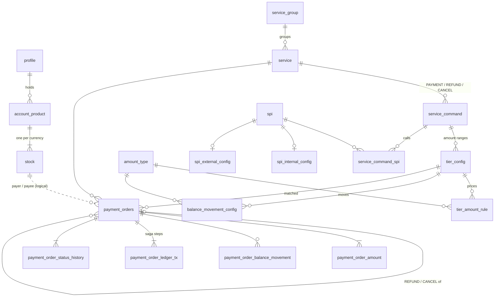
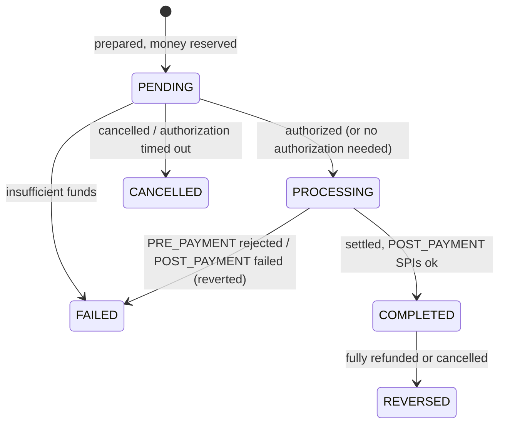
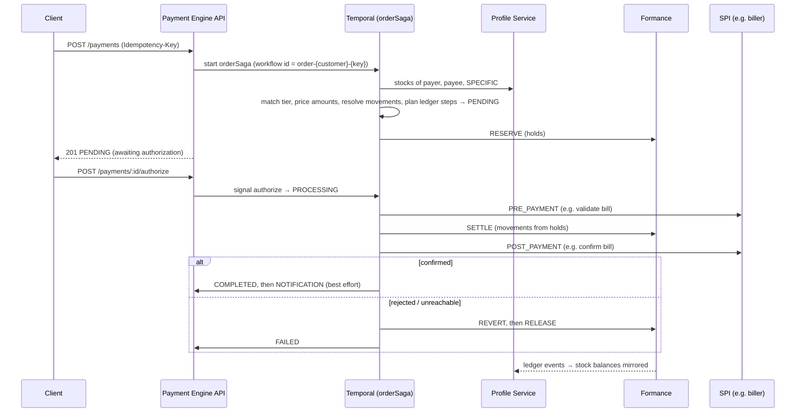

# Table schema design

The schema follows the planned **Payment Engine & Profile Schema**. Postgres holds configuration, orders and their state; **Formance is the source of truth for money**. The Profile Service mirrors balances into its `stock` table.

- **Profile Service** (database `profile`): `profile`, `account_product`, `stock`.
- **Payment Engine** (database `payment`):
  - **Configuration:** `amount_type`, `service_group`, `service`, `service_command`, `spi`, `spi_internal_config`, `spi_external_config`, `service_command_spi`, `tier_config`, `tier_amount_rule`, `balance_movement_config`.
  - **Transactions:** `payment_orders`, `payment_order_amount`, `payment_order_balance_movement`, `payment_order_status_history`, plus **`payment_order_ledger_tx`**, which was added for the saga.
- References between the two services (`customer_id` → `profile`, every `*_stock_id` / `*_account_id` → `stock`) are logical, with no foreign keys.
- Enums are Postgres enums, as in the plan. Amounts are `NUMERIC(20,2)` and travel through the APIs as decimal strings (`"21.00"`). The code computes in integer minor units (`bigint`) or exact fractions and never uses floats.

## Profile Service

| Table | Purpose | Key rules |
| --- | --- | --- |
| `profile` | Customer (`INDIVIDUAL`), `AGENT`, or the bank itself (`INTERNAL`) | CIF `profile_number` from a sequence; `ACTIVE` only with `kyc_verified` (except `INTERNAL`) |
| `account_product` | An account a profile holds | `CURRENT` → individuals; `AGENT_FLOAT`, `COMMISSION` → agents; `INTERNAL` (fee income, settlement, VAT payable, …) → the bank; owner type pinned by a composite FK |
| `stock` | One currency balance inside an account | `ledger_account` = Formance address `{profile type}:{CIF}:{product type}:{stock number}` (ids only); one stock per currency per account |

**Defaults on create:** an `INDIVIDUAL` gets a `CURRENT` account, and an `AGENT` gets `AGENT_FLOAT` and `COMMISSION`, each with USD and KHR stocks. `INTERNAL` profiles add accounts explicitly.

**Balance mirror:** Formance POSTs every committed or reverted transaction to `POST /ledger-events`. For each stock touched (its account, or one of its hold accounts `holds:{stock number}:{order}`), the Profile Service reads absolute values back from Formance:
- `hold_amount` = Σ the stock's hold accounts.
- `ledger_balance` = stock account + `hold_amount`.
- `available_balance` = `ledger_balance − hold_amount`, a generated column.

Values are recomputed from Formance, never incremented, so a duplicate event is harmless. `POST /stocks/:id/refresh` recomputes one stock on demand. The payment engine never authorizes spending from these columns; Formance checks funds itself.

## Payment Engine — configuration

| Table | Purpose |
| --- | --- |
| `amount_type` | Amount types as data, e.g. `AMOUNT`, `FEE_FROM_CUSTOMER`, `SELLING_PRICE`, `VAT`. Codes are formula-safe (`^[A-Z][A-Z0-9_]*$`) |
| `service_group` | Groups services (Transfers, Bill payments, …); `INACTIVE` turns off every service in it |
| `service` | One payable product in **one currency**, e.g. `EDC_BILL_USD` |
| `service_command` | `PAYMENT`, `REFUND`, `CANCEL`, each with its own tiers and SPI calls |
| `tier_config` | The amount range `[min, max)` a tier covers; `NULL` = unbounded; active ranges of a command may not overlap (`EXCLUDE` constraint) |
| `tier_amount_rule` | How each amount type is calculated in a tier (below) |
| `balance_movement_config` | Which amount type moves from which stock to which, in `movement_sequence` order. `PAYER` / `PAYEE` are the order's stocks; `SPECIFIC` names a stock |
| `spi`, `spi_internal_config`, `spi_external_config` | Providers. Internal = a handler inside the engine; external = REST endpoint, auth type, `credential_ref` (the secret's name, never the secret), timeout, retries |
| `service_command_spi` | Which SPI a command calls, at `PRE_PAYMENT`, `POST_PAYMENT` or `NOTIFICATION`, in `execution_sequence` order |

**Amount rules,** applied in `calc_sequence` order:
- `FIXED`: `fixed_value + base_amount_type × percentage / 100`, e.g. FEE = 5% of AMOUNT, or FEE = 0.50.
- `FORMULA`: an expression of codes, numbers and `+ − × ÷ ( )`, e.g. `SELLING_PRICE = FEE_FROM_CUSTOMER + AMOUNT`.
- `min_value` and `max_value` cap the result, which is then rounded half up to 2 decimals. Later rules see the rounded values.

**Checks before a tier is saved:**
- A rule may only use `AMOUNT` or types calculated earlier.
- Every movement's amount type is `AMOUNT` or has a rule.
- `SPECIFIC` stocks exist in the service currency and aren't closed.
- The rules price cleanly at the range edges.

Tiers are immutable once created, because orders reference them. To change a price, switch the tier `INACTIVE` and add a new one.

**Balanced by construction:** every movement moves one amount from one stock to another, so an order can never create or lose money. The plan's from → to pairs replaced the earlier debit/credit entries and their save-time balance check.

### Example: merchant QR, up to $40 (the spec example)

| Rule | Method | Value |
| --- | --- | --- |
| 1. `FEE_FROM_CUSTOMER` | FIXED | 5% of `AMOUNT` |
| 2. `SELLING_PRICE` | FORMULA | `FEE_FROM_CUSTOMER + AMOUNT` |

| # | Amount type | From | To |
| --- | --- | --- | --- |
| 1 | `AMOUNT` | PAYER | PAYEE |
| 2 | `FEE_FROM_CUSTOMER` | PAYER | SPECIFIC: bank *Fee income* |

On a $20.00 payment the payer is held, then debited, $21.00 (the selling price). The payee receives $20.00 and fee income $1.00. A $50.00 payment matches no tier and is rejected.

## Payment Engine — orders

| Table | Purpose |
| --- | --- |
| `payment_orders` | One order executing one command. Records the matched tier, payer and payee stocks (with name snapshots), amount, currency (FK to the service's currency), `original_order_id` for REFUND / CANCEL, status and reason. `(customer_id, idempotency_key)` is unique |
| `payment_order_amount` | Every amount type calculated for the order (`AMOUNT` always, others when non-zero) |
| `payment_order_balance_movement` | The resolved stock-to-stock movements: `PENDING` → `POSTED` (with `core_reference` = Formance tx id) → `REVERSED` on compensation, or `FAILED` |
| `payment_order_status_history` | Every status change, with `reason_code` and `changed_by` (`SYSTEM`, `customer:{id}`, …) |
| `payment_order_ledger_tx` | **Added for the saga:** the order's Formance transactions with their planned postings, status and ledger tx id |

**Saga ledger transactions** (`payment_order_ledger_tx.step`), each posted once with reference `{order id}:{step}`:

| Step | What it does | When |
| --- | --- | --- |
| `RESERVE` | Money leaving the payer / payee stocks moves to `holds:{stock number}:{order id}` | First, before authorization (skipped when only bank stocks pay) |
| `SETTLE` | The balance movements, paid from the holds | After authorization and `PRE_PAYMENT` SPIs |
| `REVERT` | Formance revert of `SETTLE` | Compensation: a `POST_PAYMENT` SPI failed |
| `RELEASE` | The holds go back to their stocks | Compensation: cancelled, timed out, PRE / POST_PAYMENT failed |

**Overdraft:** `INTERNAL` (bank) stocks may go negative, e.g. the settlement account on cash-in. Customer and agent stocks never can, and Formance enforces it.

**Order lifecycle** (`payment_status`):

Reason codes fit `VARCHAR(20)`: `INSUFFICIENT_FUNDS`, `AUTH_TIMEOUT`, `CANCELLED_BY_USER`, `PRE_PAY_REJECTED`, `PRE_PAY_FAILED`, `POST_PAY_REJECTED`, `POST_PAY_FAILED`, `FULLY_REFUNDED`, `CANCELLED`.

**Reversals:**
- `REFUND` and `CANCEL` are orders of their own, priced by their command's tiers, with the original's payer and payee.
- The original must be `COMPLETED` and is locked while the reversal is checked.
- `CANCEL` reverses the full amount, and only if nothing was refunded.
- A `REFUND` can be partial but never exceeds what's left.
- When reversals reach the full amount, the original becomes `REVERSED`.
- `POST /payments/:id/cancel` on a `PENDING` order cancels it before authorization instead.

**Authorization:**
- Customer and agent `PAYMENT` orders wait in `PENDING` (funds held) for `POST /payments/:id/authorize`, a PIN / OTP step in a real app. If none arrives within `AUTH_TIMEOUT_SECONDS` (default 300), the order is `CANCELLED` and the hold released.
- Orders paid by the bank (`INTERNAL` payer, e.g. cash-in) and REFUND / CANCEL orders run without it.

## Order saga (Temporal)

- The API waits up to `SAGA_WAIT_MS` (5 s) for the step the caller cares about. It returns 201 if the saga got there, otherwise 202 with the order as it stands.
- Every activity is idempotent: ledger references, and status transitions that ignore moves out of a final status.
- If a compensation (`REVERT` / `RELEASE`) is itself refused by the ledger, the workflow fails with `CompensationFailed`, so an operator sees it in the Temporal UI.

## Required indexes

All created by the migrations:
- `payment_orders`: `(customer_id, idempotency_key)` unique, `(customer_id, created_at desc)`, `(payer_account_id, created_at desc)`, `(payee_account_id, created_at desc)`, `idx_po_in_flight` (partial: `PENDING` / `PROCESSING`), `external_reference`, `original_order_id`.
- `payment_order_balance_movement`: `idx_pobm_pending` (partial).
- `payment_order_status_history`: `(payment_order_id, changed_at)`.
- `account_product`: `profile_id`.
- `tier_config`: the `EXCLUDE` constraint on active ranges.
