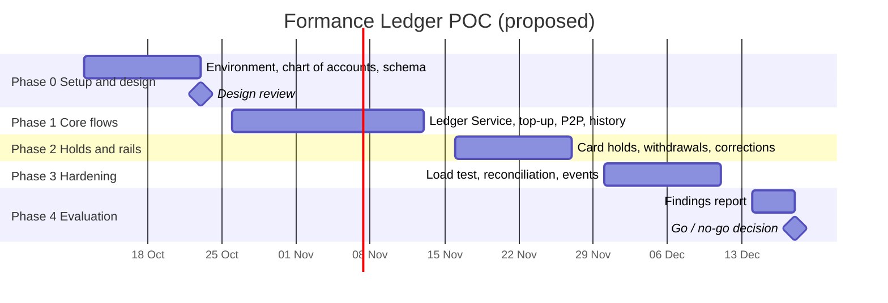

# Implementation plan

The POC runs 10 weeks in five phases, from 12 Oct to 18 Dec 2026 (proposed dates), and ends in a go/no-go decision. Each phase ends with a demo and must meet its exit criteria before the next phase starts.

| Phase | Weeks | Deliverables | Exit criteria |
| --- | --- | --- | --- |
| 0. Setup and design | 1–2 | Formance environment (Cloud sandbox or self-hosted via Docker/Kubernetes); chart of accounts; Postgres schema migrations; Numscript templates checked against v3.2 docs | Design review signed off by engineering and finance |
| 1. Core flows | 3–5 | Ledger Service with outbox and retries; top-up webhook; P2P with fee; balance and history APIs; idempotency | P2P and top-up pass integration tests, including retries and insufficient funds |
| 2. Holds and rails | 6–7 | Card authorize / capture / release with expiry job; withdrawal via transit account; revert-based corrections; partner and processor mocks | Every flow has a tested success path and failure path |
| 3. Hardening | 8–9 | Load and concurrency tests; ledger events → read models and warehouse; daily reconciliation job; failure-injection tests (timeouts, duplicate webhooks); integrity check | Success criteria below are measured |
| 4. Evaluation | 10 | Findings report, cost estimate, production architecture, Cloud vs. self-hosted recommendation | Go/no-go decision |

**Proposed team:** 2 backend engineers (full time), 1 DevOps engineer (half time, Phase 0 and 3), 1 QA engineer (half time from Phase 1), 1 finance or operations reviewer (design review and reconciliation).

## POC success criteria

The POC passes only if every correctness criterion holds; performance targets are proposed and should be replaced with our own volume forecast.

| Area | Test | Pass condition |
| --- | --- | --- |
| Correctness | 1,000 concurrent debits against one account with too little money for all of them | Balance never below 0 (or the overdraft limit); accepted total = starting balance |
| Correctness | Sum of all balances per asset, including `@world` | Exactly 0 after every test run |
| Idempotency | Same request replayed 10 times, including after a timeout | Exactly one ledger transaction |
| Holds | Authorize, partially capture, let the remainder expire | Customer gets the remainder back; hold account ends at 0 |
| Failure handling | Kill the Ledger Service mid-request | Outbox completes or fails every pending transfer; nothing lost or doubled |
| Performance | Sustained load at the target peak (proposed: 200 transactions/s) | p99 latency under 300 ms for posting; no errors |
| Hot accounts | Fee account receiving postings from all transfers | Throughput stays within 20% of the overall peak |
| Queries | Customer history, 50 items per page, filtered by type | p95 under 200 ms |
| Reconciliation | Daily run against a mock partner statement with 3 planted mismatches | All 3 found, no false positives |
| Audit | Ledger integrity verification | Passes on the full POC data set |

## Risks and mitigations

| Risk | Impact | Mitigation |
| --- | --- | --- |
| Data residency: regulator requires customer financial data in-country | Cloud may be ruled out | Confirm with compliance in Phase 0; test self-hosted in parallel if unclear |
| Hot accounts (fees, settlement) limit throughput | Slower transfers at peak | Load-test in Phase 3; split fees into sharded accounts (e.g. `platform:fees:p2p:{0..n}`) if needed |
| Ledger and Postgres disagree after a partial failure | Wrong transfer status shown to customers | Outbox with unique `reference`; a nightly job compares `transfers` with ledger transactions |
| Vendor lock-in | Costly to migrate later | Keep Numscript behind the Ledger Service interface; Formance core is open source and self-hostable |
| EE license cost | Budget overrun | Price EE modules separately; build holds and reconciliation ourselves if EE is not justified |
| Team learning curve for Numscript and double-entry | Slower Phase 1 | Templates reviewed by finance; shared test suite of example transactions |
| Wrong asset precision or account design | Painful migration later | Finance sign-off on chart of accounts and precision at the Phase 0 design review |

## Open decisions and next steps

- [ ] Approve the 10-week POC and team
- [ ] Formance Cloud or self-hosted for the POC (depends on data-residency answer)
- [ ] Request an Enterprise trial for Wallets, Payments and Reconciliation, or build those parts ourselves
- [ ] Confirm KHR precision (`KHR/2` assumed per ISO 4217; `KHR/0` if we only handle whole riel)
- [ ] Confirm peak volume forecast to replace the proposed 200 transactions/s target
- [ ] Name the partner bank whose webhooks we will mock
- [ ] Schedule the Phase 0 design review with finance

## Sources

- [Formance Ledger overview, v3.2](https://docs.formance.com/v3.2/modules/ledger?deployment=cloud&license=ee)
